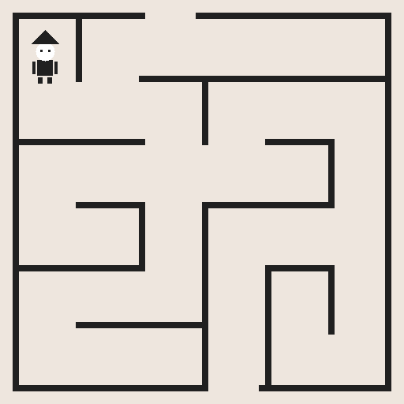

# Laboratorio de Organización de Computadoras

Integrantes: Sanchez, Solana y Rubies.

## Ejercicio 1

Imagen estática de 512 × 512 píxeles con un laberinto y un personaje, dibujados mediante procedimientos en ensamblador ARMv8. El código de `app.s` utiliza instrucciones de la GreenCard y `MOV`.



Para compilar con las herramientas de la cátedra:

```sh
cd ejercicio1
make
```

Copiar el archivo generado `kernel8.img` a la SD preparada según la guía. El archivo `main.s` conserva la inicialización original de la plantilla.

La compilación y el dibujo se verificaron mediante emulación ARMv8. Queda pendiente la prueba en la Raspberry Pi y el informe con imágenes de los resultados en la placa.

Antes de comprimir la entrega, ejecutar `make clean`. Los archivos generados durante la compilación se excluyen del repositorio.

## Ejercicio 2

Continúa el laberinto del ejercicio 1 con movimiento mediante pulsadores, colisiones y una meta verde en la salida inferior. El led rojo indica que la partida está en curso; al ganar se apaga y el verde se enciende durante tres segundos. Después, ambos quedan apagados y la imagen permanece visible hasta reiniciar la placa.

Compilar ejecutando `make` dentro de `ejercicio2`. Ver [explicación y mapeo de botones](ejercicio2/README.md).
