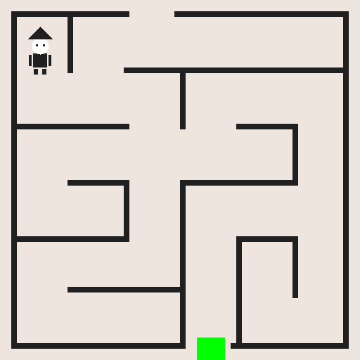

# Ejercicio 2



## Funcionamiento

Se conserva el laberinto del ejercicio 1. El personaje comienza arriba a la izquierda y debe llegar a la marca verde en la abertura inferior, realizando varios cambios de dirección.

Cada lectura mueve al personaje dos píxeles en una dirección. Mantener un pulsador presionado repite el movimiento; se esperan 20 milisegundos entre intentos. Si hay varios botones presionados, la prioridad es arriba, abajo, izquierda y derecha.

El personaje ocupa una caja de 35 × 68 píxeles. Primero se verifica que la posición propuesta quede dentro de la pantalla. Luego se borra la posición anterior, se restaura la marca verde y se comprueba que la caja propuesta no contenga píxeles del color de las paredes. Si hay una pared, se conserva la posición anterior. Finalmente se dibuja nuevamente el personaje. Este criterio deja un pequeño margen alrededor de su silueta.

El led rojo (GPIO3) permanece encendido durante la partida. Cuando el personaje toca la meta con su centro horizontal dentro de la marca, el rojo se apaga y el verde (GPIO2) se enciende durante tres segundos. Al terminar, se apagan ambos y se entra en un bucle infinito. Para jugar otra vez se reinicia la placa.

Los tiempos se miden leyendo el contador CLO del System Timer, documentado en las páginas 172–173 del manual BCM2835 proporcionado. Se usa la dirección física `0x3F003004`. La resta de 32 bits permite esperar aunque el contador desborde.

## Pulsadores y leds

Las constantes al principio de `gpio.s` corresponden a la placa recibida, la de la foto izquierda de la página 5 de la guía:

| Dirección | GPIO |
| --- | --- |
| Arriba | GPIO14 |
| Abajo | GPIO18 |
| Izquierda | GPIO15 |
| Derecha | GPIO17 |

Los pulsadores se leen activos en alto y los leds son activos en bajo, según la guía.

La configuración de GPIO modifica solamente los campos de los pines utilizados. Sus registros se acceden mediante operaciones de 32 bits, según el manual BCM2835, páginas 90–95, usando la base `0x3F200000` indicada en la guía.

Conectar la placa de pulsadores en la posición indicada por la guía y con la Raspberry apagada.

## Código y compilación

`app.s` contiene el dibujo y el juego; `gpio.s`, la configuración de los pines y el manejo de los botones y leds. `main.s` se conserva sin cambios. Los procedimientos gráficos emplean temporales X9–X15; la posición y el estado del juego se mantienen en X19–X26. El procedimiento que dibuja el personaje guarda su retorno en X27 antes de llamar a los procedimientos gráficos. No se utiliza la pila.

Las instrucciones del código agregado corresponden a la GreenCard, con su sintaxis ARMv8, más `MOV`. Todas las figuras se generan por código, sin imágenes almacenadas para copiarlas al framebuffer.

```sh
cd ejercicio2
make
```

Copiar `kernel8.img` a la SD preparada con los archivos suministrados por la cátedra. Antes de comprimir la entrega, ejecutar `make clean`.

## Verificación realizada

Compilación con el Makefile y el ensamblador de la plantilla, sin errores ni advertencias. En emulación ARMv8 se verificaron el reposo, las cuatro direcciones, los choques, la configuración GPIO preservando los campos ajenos, y un recorrido completo de 515 pasos hasta la meta. También se comprobaron la secuencia de leds, la espera con desborde del contador, la conservación de las paredes y el borrado sin rastros del personaje. La vista previa proviene del framebuffer generado por el programa emulado.

Queda pendiente probar en la Raspberry los pulsadores, la velocidad de movimiento y los leds. La vista previa no reemplaza las fotografías del resultado en hardware solicitadas para el informe de entrega.
